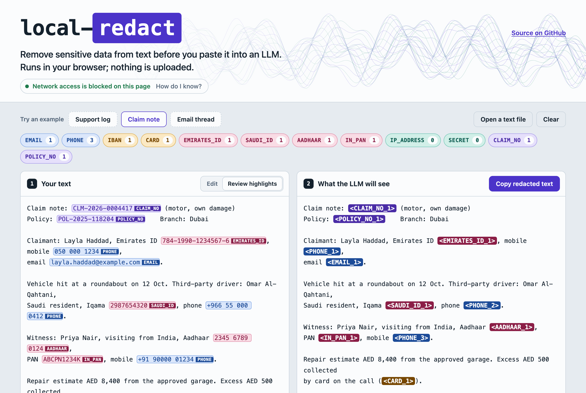

# local-redact

Remove sensitive data from text before you paste it into an LLM. Runs in your browser; nothing is uploaded.

**[Open the app](https://sumankrsh.github.io/local-redact/)** · [open it with a sample claim note](https://sumankrsh.github.io/local-redact/#example=claim-note)

[](https://sumankrsh.github.io/local-redact/#example=claim-note)

Paste a log, a claim note or an email thread. local-redact finds email addresses, phone numbers, IBANs, card numbers, Emirates IDs, Saudi IDs and Iqamas, Aadhaar and PAN numbers, IP addresses and API keys. It swaps each one for a numbered placeholder such as `<EMAIL_1>`. The mapping stays on your machine, so when the model answers you can put the real values back.

I built it for the kind of text support and claims teams in the Gulf and India paste into chat tools: logs, claim notes, email threads. Presidio, the best-known open-source option, covers many countries but lists no UAE or Saudi identifiers. This tool checks each Gulf and Indian ID against its checksum or format rule before redacting it, and the browser version cannot send anything anywhere.

There are two ways to use it, and both find the same things:

- **Browser app**: a static page with no build step and no dependencies. Paste text or drop a file, see what was found, switch types on and off, add an allowlist or your own patterns, then copy the result.
- **Python package and CLI** (`local-redact`): redacts files or stdin, writes a JSON report, and restores answers. Standard library only.

Both read one pattern spec ([`patterns/*.json`](patterns)) and pass the same test fixtures. CI fails if they ever disagree.

## Quick start

**In the browser:** open the [hosted app](https://sumankrsh.github.io/local-redact/), or clone the repo and open `web/index.html` straight from disk (tested in Chrome). To serve it locally instead:

```bash
python3 -m http.server --directory web 8000
```

**On the command line** (Python 3.10 or newer, no dependencies):

```bash
git clone https://github.com/sumankrsh/local-redact.git
cd local-redact
python3 -m pip install .
local-redact redact samples/claim-note.txt
```

Or install straight from GitHub with `pipx install git+https://github.com/sumankrsh/local-redact.git`. The package is not on PyPI.

## Reversible mode

Redact with `--map`, paste the redacted text into the model, then restore its answer with the same map. Here is a real run on a short synthetic note. `--pattern` adds a format the tool does not know, in this case a claim number:

```console
$ cat note.txt
Hi, this is Layla Haddad (Emirates ID 784-1990-1234567-6). Please refund
AED 500 to AE07 0331 2345 6789 0123 456 and confirm on 050 000 1234
or layla.haddad@example.com. Claim CLM-2026-0004417.

$ local-redact redact note.txt --map note.map.json --pattern CLAIM_NO="CLM-[0-9]{4}-[0-9]{7}"
local-redact: 5 redacted (CLAIM_NO 1, EMAIL 1, EMIRATES_ID 1, IBAN 1, PHONE 1)
local-redact: mapping saved to note.map.json (keep it private)
Hi, this is Layla Haddad (Emirates ID <EMIRATES_ID_1>). Please refund
AED 500 to <IBAN_1> and confirm on <PHONE_1>
or <EMAIL_1>. Claim <CLAIM_NO_1>.
```

The name "Layla Haddad" is still there. Names are not detected (see [Limits](#limits)). Suppose the model replies:

```console
$ cat answer.txt
Thanks. I will refund AED 500 to <IBAN_1> today and send the confirmation to
<EMAIL_1> for claim <CLAIM_NO_1>.

$ local-redact restore answer.txt --map note.map.json
local-redact: 3 placeholder(s) restored
Thanks. I will refund AED 500 to AE07 0331 2345 6789 0123 456 today and send the confirmation to
layla.haddad@example.com for claim CLM-2026-0004417.
```

How it works:

- The same value always gets the same placeholder, so the model can tell that two mentions are the same person or account.
- Placeholders that already appear in your text are never reused.
- Running `redact` again with the same `--map` continues the numbering, which keeps placeholders consistent across several files.
- The map file holds the real values. The CLI creates it readable by you only (mode 600). Keep it out of git (`.gitignore` here already excludes `*.map.json`).
- In the browser the mapping lives in the tab. You can download it, or load a saved one later to restore an answer.
- `restore` swaps only exact placeholders. It lists any `<TYPE_N>` it does not know (`--strict` makes that an error), so ask the model to keep placeholders exactly as written.

### Other CLI options

```bash
cat app.log | local-redact redact > app.redacted.log          # stdin to stdout
local-redact redact a.txt b.txt --out-dir redacted/          # several files, shared numbering
local-redact redact notes.txt --json                         # JSON report (types, offsets, placeholders)
local-redact redact notes.txt --json --include-values        # ...with the original values
local-redact redact notes.txt --skip SAUDI_ID,IP_ADDRESS     # or --types EMAIL,PHONE
local-redact redact notes.txt --allow support@example.com    # never redact this value
local-redact redact notes.txt --config settings.json         # settings exported from the web app
local-redact redact notes.txt --check                        # exit 1 if anything was found
local-redact types                                           # list detectors and their rules
```

JSON offsets are Unicode code-point indices, the same as Python string indices.

## What it detects

Each detector is a JSON file in [`patterns/`](patterns) with its regexes, validation rule, sources and examples. Where a checksum exists, a value must pass it before it is redacted. A number with the right shape but a wrong check digit is left alone.

| Type | What | How it is validated | Rule source |
|---|---|---|---|
| `EMAIL` | Email addresses | Strict format; the domain must end in a letters-only TLD | [WHATWG HTML](https://html.spec.whatwg.org/multipage/input.html#valid-e-mail-address) (narrower) |
| `PHONE` | International, GCC and Indian numbers | `+` or `00` with 8–15 digits (the E.164 maximum is 15); local GCC mobiles `05X XXX XXXX`; Indian mobiles starting 6–9 | [ITU-T E.164](https://www.itu.int/rec/T-REC-E.164), [libphonenumber metadata](https://github.com/google/libphonenumber/blob/master/resources/PhoneNumberMetadata.xml) |
| `IBAN` | IBANs for 89 countries, including AE, SA, QA, KW, BH, OM | Per-country length, then ISO 13616 mod-97 | [SWIFT IBAN registry](https://www.swift.com/swift-resource/11971/download), [python-stdnum `iban.dat`](https://github.com/arthurdejong/python-stdnum/blob/master/stdnum/iban.dat) |
| `CARD` | Payment cards | 13–19 digits, a known scheme prefix (Visa, Mastercard, Amex, Discover, JCB, Diners, UnionPay, RuPay, Maestro), Luhn | ISO/IEC 7812-1; [Luhn](https://en.wikipedia.org/wiki/Luhn_algorithm), [prefixes](https://en.wikipedia.org/wiki/Payment_card_number) |
| `EMIRATES_ID` | UAE Emirates ID, `784-YYYY-NNNNNNN-C` | 15 digits starting 784, Luhn check digit | [Microsoft Purview definition](https://learn.microsoft.com/en-us/purview/sit-defn-uae-identity-card-number) |
| `SAUDI_ID` | Saudi national ID and Iqama | 10 digits starting 1 (citizen) or 2 (resident), Luhn check digit | [SAMA rulebook](https://rulebook.sama.gov.sa/en/node/2420) for the structure; [community validator](https://github.com/alhazmy13/Saudi-ID-Validator/blob/master/validateSAID.py) for the formula |
| `AADHAAR` | Aadhaar | 12 digits, first digit 2–9, not a palindrome, Verhoeff check digit | [python-stdnum `aadhaar.py`](https://github.com/arthurdejong/python-stdnum/blob/master/stdnum/in_/aadhaar.py), [UIDAI numbering paper](https://web.archive.org/web/20140611025606/http://uidai.gov.in/UID_PDF/Working_Papers/A_UID_Numbering_Scheme.pdf) |
| `IN_PAN` | Indian PAN | `AAAAA9999A`, 4th letter one of A B C F G H J L P T. The last letter is a check character whose formula is not published, so it is not verified | [Income Tax Department](https://www.incometaxindia.gov.in/w/how-pan-is-formed-and-how-it-gets-its-unique-identity-) |
| `IP_ADDRESS` | IPv4 and IPv6 | IPv4 octets 0–255 with no leading zeros; full RFC 4291 IPv6 text form, including `::` and an IPv4 tail | [RFC 791](https://www.rfc-editor.org/rfc/rfc791), [RFC 4291 §2.2](https://www.rfc-editor.org/rfc/rfc4291#section-2.2) |
| `SECRET` | AWS access key IDs; GitHub, Slack and Stripe tokens; Google, OpenAI and Anthropic API keys; JWTs; bearer tokens; PEM private keys | Vendor prefix plus length and character set. A JWT's header must decode to JSON with an `alg` field | Vendor docs ([AWS](https://docs.aws.amazon.com/IAM/latest/UserGuide/reference_identifiers.html), [GitHub](https://docs.github.com/en/authentication/keeping-your-account-and-data-secure/about-authentication-to-github), [Slack](https://docs.slack.dev/authentication/tokens), [Stripe](https://docs.stripe.com/keys)), [gitleaks rules](https://github.com/gitleaks/gitleaks/blob/master/config/gitleaks.toml), [RFC 7519](https://www.rfc-editor.org/rfc/rfc7519), [RFC 7468](https://www.rfc-editor.org/rfc/rfc7468) |

Two of these rules come from secondary sources, not the issuer. The UAE and Saudi authorities do not publish their check-digit formulas. The Emirates ID rule follows data-loss-prevention vendor documentation, and the Saudi rule is the widely used community one. If either is wrong for some real IDs, those IDs would be missed, not wrongly flagged.

GitHub changed its installation tokens in 2026 to a longer `ghs_APPID_JWT` form ([changelog](https://github.blog/changelog/2026-10-02-stateless-github-app-installation-tokens-rolled-out/)). Both the old and the new forms are covered.

**Custom patterns** cover formats like policy or claim numbers. Use `--pattern NAME=REGEX` on the command line, or the Custom patterns panel in the app. **Allowlisted** values, such as your own support address, are never redacted.

When two matches overlap, the longer one wins, then the higher-priority type. For example, an email address that contains a phone number is redacted as one email.

## Tests and parity

The browser engine ([`web/engine.js`](web/engine.js)) is a line-for-line port of the Python one ([`src/local_redact/engine.py`](src/local_redact/engine.py)). These fixtures are shared by both test suites:

- [`cases.json`](tests/fixtures/cases.json): 27 hand-written edge cases. They cover overlaps, the allowlist, placeholder collisions, Arabic text around an ID, emoji, CRLF line endings, and things that must *not* match, such as times, MAC addresses and `std::vector`.
- [`generated.json`](tests/fixtures/generated.json): 350 seeded synthetic cases, written by [`scripts/generate_fixtures.py`](scripts/generate_fixtures.py). Valid and broken IDs appear in eight contexts, plus mixed documents. The generator computes check digits with its own formulas, so the tests do not just check the validators against themselves.
- [`checksums.json`](tests/fixtures/checksums.json): published test vectors. These are SWIFT registry example IBANs, Stripe test card numbers, and the Wikipedia Luhn and Verhoeff examples.
- [`samples.expected.json`](tests/fixtures/samples.expected.json): the Python output on the three samples, which the JS output must match exactly.
- The valid and invalid examples inside each pattern file.

Pytest runs these plus CLI tests. `node:test` runs them against the browser engine. CI runs Python 3.10–3.14 and Node 22 and 24. It also fails if the bundled `web/patterns.js` or the generated fixtures are out of date.

```bash
python3 -m pip install -e ".[test]"
python3 -m pytest -q
node --test tests/js/engine.test.js
node scripts/build-web.mjs           # after editing patterns/ or samples/
python3 scripts/generate_fixtures.py # then commit the updated fixtures
```

Every ID in the tests and samples is synthetic. The samples use patterned numbers (such as 1234567 or 7654321) with only the check digit computed. The test corpus uses random digits from a fixed seed. IBANs and cards also use the published examples above. None is taken from a real person.

## Privacy: what the Content-Security-Policy does

The first element in [`web/index.html`](web/index.html) is this policy:

```
default-src 'none'; script-src 'self'; style-src 'self'; img-src data:;
connect-src 'none'; form-action 'none'; base-uri 'none'; object-src 'none';
require-trusted-types-for 'script'; trusted-types 'none'
```

What each part does:

- `connect-src 'none'`: the page's scripts cannot make network requests. That blocks `fetch`, XHR, WebSocket, EventSource and `sendBeacon`.
- `img-src data:` and `default-src 'none'`: no images, fonts, frames or other resources load from anywhere. The page uses system fonts, and its only icon is inline.
- `script-src 'self'`: only the page's own four script files run. No inline or third-party scripts.
- `form-action 'none'` and `base-uri 'none'`: forms cannot submit anywhere, and links cannot be redirected through a `<base>` tag.
- Trusted Types: in browsers that support them, `innerHTML`-style HTML injection is refused outright. The app builds every element with `textContent` anyway, so pasted text never becomes markup.

I checked this in Chrome. With the app loaded, a `fetch`, a `sendBeacon`, a WebSocket and a cross-origin image were each blocked with a CSP violation. The browser's network log showed no request to the test host. You can repeat the check: open developer tools, go to the Network tab, and paste some text. After the page, its stylesheet and its four scripts load, nothing else is requested.

What the policy does not cover:

- GitHub Pages cannot send custom HTTP headers, so the policy is in a `<meta>` tag. It applies from that point on, which is why it comes first in `<head>`.
- Browser extensions are not bound by a page's policy.
- Nothing stops you pasting the text somewhere unsafe. The tool only controls what the page itself does.
- If a copy of the page lacks `connect-src 'none'`, it shows a red warning in place of "Network access is blocked on this page".

The Python package has no network code. It uses the standard library only and never imports a networking module.

## How it compares with Presidio

[Presidio](https://github.com/data-privacy-stack/presidio) (formerly `microsoft/presidio`) is the established open-source PII framework, and for many jobs it is the better choice. Here is how the two differ, based on Presidio's [supported entities](https://presidio.dataprivacystack.org/supported_entities/) and [anonymizer](https://presidio.dataprivacystack.org/anonymizer/) docs as of October 2026:

| | local-redact | Presidio |
|---|---|---|
| Names, places, organisations | Not detected | Detected with an NLP model (spaCy `en_core_web_lg` by default) |
| Country-specific IDs | UAE Emirates ID and Saudi ID/Iqama (with checksums); Aadhaar and PAN | Many countries, including Aadhaar (with checksum) and PAN. No UAE, Saudi or other GCC IDs listed |
| Phone numbers | Regex for international, GCC and Indian formats | Custom logic, pattern match and context (per its docs) |
| Reversible | Numbered placeholders and a local mapping; `restore` puts values back | `encrypt` operator with a matching `decrypt` deanonymizer |
| Where it runs | In a browser tab, offline, or as a dependency-free CLI | Python library or Docker services; needs a spaCy model for NER |
| Images, structured data | No | Yes |

Use Presidio if you need names, addresses or broad country coverage in a pipeline. Use this tool if you need Gulf IDs, or want something anyone on a team can run in a browser with nothing to install and nothing uploaded. The two can also be combined.

## Limits

- **It matches patterns and checksums; it is not a language model.** Names, street addresses, dates of birth and free-text details, such as a diagnosis, are not detected. Always read the output before you paste it.
- **Checksums reduce false positives but do not remove them.** About 1 in 10 random numbers of the right shape pass Luhn or Verhoeff. So some 10-digit numbers starting with 1 or 2 (including some Unix timestamps) will be flagged as Saudi IDs, and some 12-digit numbers as Aadhaar. In logs you may want `--skip SAUDI_ID`.
- **A four-part version string such as `1.2.3.4` is a valid IPv4 address** and will be redacted.
- **Not detected:**
  - numbers in Arabic-Indic digits (٠١٢…)
  - lower-case IBANs, or IBANs with other spacing
  - local landline numbers without a country code
  - 12-digit Maestro cards
  - secrets without a known prefix, such as a password in a config file (add a custom pattern)
- **Restore is exact.** If the model rewrites `<EMAIL_1>` as `EMAIL_1` or `[EMAIL_1]`, that mention is not restored.
- **Text only.** Convert PDFs, Word files and images to text first.
- **Custom patterns** run as JavaScript regexes in the browser and as Python `re` patterns in the CLI. Most simple patterns behave the same in both, but not all do.

## Project layout

```
patterns/           one JSON file per detector: regexes, validator, sources, examples
src/local_redact/   Python engine, validators and CLI
web/                the browser app (index.html, app.js, engine.js, generated patterns.js and samples.js)
samples/            three synthetic sample texts used by the app and the tests
tests/              pytest suites, node:test suite, shared fixtures
scripts/            web bundler, synthetic data and fixture generators
```

---

Built by Suman Mukherjee · contactme@mukherjeesuman.com · [mukherjeesuman.com](https://mukherjeesuman.com)

MIT licence.
